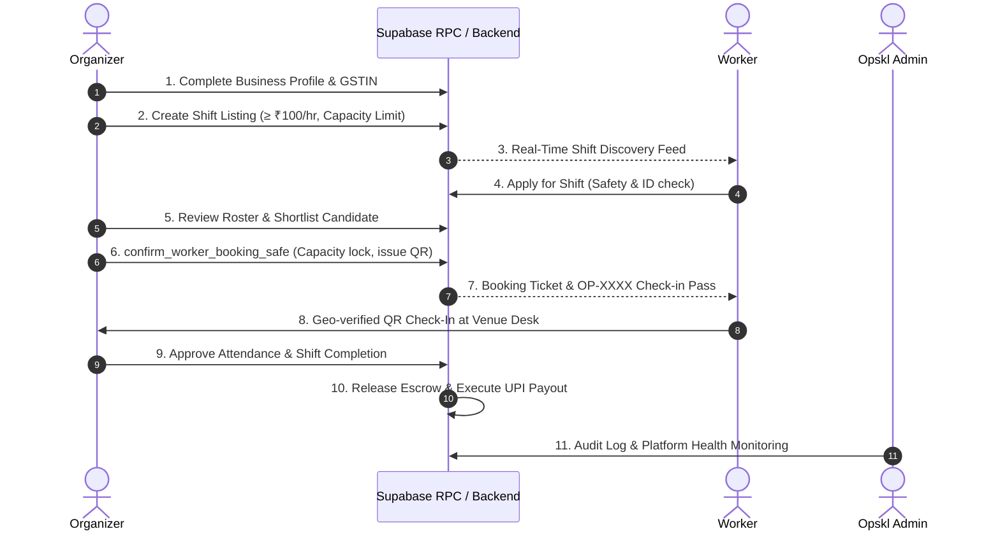

# OPSKL — Master Project Architecture & Operations Runbook

## 1. Project Overview & Mission

**Opskl** is an on-demand, two-sided event staffing marketplace built specifically for single-day paid event shifts in India, launching initially in the **Mumbai Metropolitan Region (MMR)**.

- **For Event Organizers**: Discover, review, and confirm verified on-ground personnel (hosts, ushers, registration assistants, crowd directors, VIP coordinators) with transparent escrow funding, attendance verification, and instant UPI settlement.
- **For Temporary Workers**: Discover nearby daily event opportunities, apply directly, check in via secure geo-stamped QR codes, and receive direct-to-bank UPI earnings upon verified supervisor check-out.
- **Core Standard**: Zero-demo live architecture, strict Apple-grade monochrome visual system (`#000000`, `#FFFFFF`, `#F5F5F5`, `#737373`), statutory minimum living wage floor (≥ ₹100/hr in Mumbai), and atomic capacity safety across all booking operations.

---

## 2. Monorepo Architecture & Structure

The repository is structured as an npm workspaces monorepo:

```
OPSKIL/
├── apps/
│   ├── worker/               # React Native / Expo application for event workers
│   │   ├── app/              # Expo Router filesystem routing (welcome, auth, tabs)
│   │   │   ├── (tabs)/       # Discover, My Shifts, Earnings, Profile
│   │   │   ├── welcome.tsx   # Worker first-run value proposition screen
│   │   │   └── onboarding.tsx# Verification and profile completion flow
│   │   └── src/              # Worker hooks, discovery feed, swipe components
│   │
│   ├── organizer/            # React Native / Expo application for event organizers
│   │   ├── app/              # Expo Router filesystem routing
│   │   │   ├── (tabs)/       # Shifts, Post, Roster, Finances, Profile
│   │   │   ├── welcome.tsx   # Organizer first-run onboarding screen
│   │   │   └── shift/[id].tsx# Shift management & supervisor check-in desk
│   │   └── __tests__/        # Organizer test suite
│   │
│   └── admin/                # Next.js 15 (App Router) desktop operations console
│       ├── src/app/          # Admin dashboard, login, verifications, disputes
│       ├── src/components/   # Metric cards, audit tables, emergency killswitch
│       └── src/lib/          # Supabase service role client & admin helpers
│
├── packages/
│   ├── design-system/        # Shared Apple-standard monochrome UI library
│   │   ├── src/components/   # Card, Button, Input, Badge, WageText, Skeletons
│   │   ├── src/theme/        # Strict neutral color tokens, radii, typography
│   │   └── src/context/      # OpsklThemeProvider, AuthProvider, ErrorBoundary
│   │
│   ├── shared/               # Core business logic, Supabase client, and RPCs
│   │   ├── src/supabase/     # Safe RPC bindings (jobs, applications, bookings, profiles)
│   │   ├── src/types/        # Database models & marketplace entities
│   │   ├── src/utils/        # Indian currency formatting (INR), dates, UPI validation
│   │   └── src/__tests__/    # Monorepo test suites (14 suites, 165+ tests)
│   │
│   └── validation/           # Shared Zod validation schemas
│       └── src/schemas/      # Shift creation, GSTIN, UPI, authentication schemas
│
├── supabase/
│   ├── migrations/           # Versioned PostgreSQL migration scripts
│   └── full_schema_release.sql # Complete zero-demo database schema & RPC functions
│
├── docs/                     # Engineering, security, and release playbooks
├── PROJECT_RUNBOOK.md        # This master operations document
└── package.json              # Monorepo workspace configuration & root scripts
```

---

## 3. Technology Stack & Key Dependencies

| Layer | Technology | Key Capabilities |
| :--- | :--- | :--- |
| **Mobile Apps** | React Native, Expo SDK 52, Expo Router | Universal iOS & Android apps with native gestures and navigation |
| **Desktop Admin** | Next.js 15, React 19, Tailwind CSS | Fast operational dashboard for verifications, audit logs & dispute resolution |
| **Backend / DB** | Supabase (PostgreSQL 15), Row Level Security | Multi-tenant isolation, atomic RPC stored procedures, real-time channels |
| **Design System** | Custom Vanilla React Native / Web | Strict monochrome system (`#000000`/`#FFFFFF`), accessible touch targets |
| **Validation** | Zod | Runtime schema validation for GSTIN, UPI IDs, hours, and living wage rules |
| **Testing** | Jest, ts-jest | Unit, integration, concurrency, and E2E lifecycle test suites |

---

## 4. Environment Configuration

The monorepo uses `.env` in the workspace root and per-app overrides when needed:

```bash
# Supabase Configuration
EXPO_PUBLIC_SUPABASE_URL="https://your-project.supabase.co"
EXPO_PUBLIC_SUPABASE_ANON_KEY="your-anon-key"
SUPABASE_SERVICE_ROLE_KEY="your-service-role-key" # Admin / CI only

# Application Modes
EXPO_PUBLIC_APP_ENV="development" # or "production"
PAYMENT_GATEWAY_MODE="sandbox"     # or "live"
```

*Templates available in [`.env.example`](file:///Users/aryan/Desktop/PROJECTS/OPSKIL/.env.example) and [`.env.production.template`](file:///Users/aryan/Desktop/PROJECTS/OPSKIL/.env.production.template).*

---

## 5. How to Run Every Application

### Quick Command Reference

```bash
# 1. Run Worker Mobile App
npm run start:worker            # Start Expo Metro bundler on port 8081
npm run ios:worker              # Launch directly in iOS Simulator
npm run android:worker          # Launch directly in Android Emulator

# 2. Run Organizer Mobile App
npm run start:organizer         # Start Expo Metro bundler on port 8082
npm run ios:organizer           # Launch directly in iOS Simulator
npm run android:organizer       # Launch directly in Android Emulator

# 3. Run Admin Desktop Portal
npm run dev:admin               # Start Next.js App at http://localhost:3000
npm run build:admin             # Production build validation

# 4. Run Test Suites & Quality Checks
npm test                        # Run all monorepo Jest test suites (340 tests)
npm run test:brutal             # Run high-concurrency race condition and boundary tests (17 tests)
npm run test:sql                # Run live database RPC and migration invariant tests (26 checks)
npm run typecheck               # Validate TypeScript across all 6 workspaces

```

---

### Running Both Mobile Apps Concurrently

Because both the Worker and Organizer apps are built with Expo, running them simultaneously requires distinct Metro ports:

1. **Terminal 1 (Organizer App)**:
   ```bash
   npx expo start apps/organizer --port 8081
   ```
   *Press `i` to open in the active iOS simulator, or `a` for Android.*

2. **Terminal 2 (Worker App)**:
   ```bash
   npx expo start apps/worker --port 8082
   ```
   *Press `i` or `a` to open in a second simulator or alongside.*

3. **Terminal 3 (Admin Console)**:
   ```bash
   npm --workspace=@opskil/admin run dev -- -p 3000
   ```
   *Open [http://localhost:3000](http://localhost:3000) in your browser.*
   - **Admin Portal**: [http://localhost:3000/login](http://localhost:3000/login)
   - **Administrator Account**: Configured via `ADMIN_EMAIL` and `ADMIN_PASSWORD` environment variables during provisioning
   - **Provision/Update Admin Script**: `ADMIN_PASSWORD="<secure_password>" node scripts/create_admin.mjs [email]`

---

## 6. End-to-End Operational Lifecycle

The Opskl platform executes an 11-step zero-demo lifecycle:



### Safety & Integrity Mechanisms

1. **Capacity Limit Protection**: All booking confirmations run through the atomic database function `confirm_worker_booking_safe`. This prevents race conditions or double-booking beyond the designated headcount limit.
2. **Indian Statutory Living Wage Floor**: Shift creation enforces `hourlyRate >= 100` via both client-side Zod validation (`ShiftCreateSchema`) and server-side PostgreSQL check constraints.
3. **Escrow Hold & Verified Check-Out**: Organizer funds are calculated with a 15% platform fee + 18% GST and held in escrow until attendance is approved.
4. **Killswitch & Platform Circuit Breaker**: The Admin console includes an immediate operational freeze switch (`bookings_paused`) to pause shifts platform-wide during emergencies.

---

## 7. Testing & Quality Standards

Opskl maintains 100% test pass rates across all packages:

- **E2E Lifecycle Suites**: [`packages/shared/src/__tests__/e2e_scenarios_a_b_c_d.test.ts`](file:///Users/aryan/Desktop/PROJECTS/OPSKIL/packages/shared/src/__tests__/e2e_scenarios_a_b_c_d.test.ts)
- **Marketplace & Concurrency**: [`packages/shared/src/__tests__/marketplace.test.ts`](file:///Users/aryan/Desktop/PROJECTS/OPSKIL/packages/shared/src/__tests__/marketplace.test.ts)
- **Trust, Security & Admin**: [`packages/shared/src/__tests__/admin_and_trust.test.ts`](file:///Users/aryan/Desktop/PROJECTS/OPSKIL/packages/shared/src/__tests__/admin_and_trust.test.ts)
- **Validation Schemas**: [`packages/validation/src/__tests__/validation.test.ts`](file:///Users/aryan/Desktop/PROJECTS/OPSKIL/packages/validation/src/__tests__/validation.test.ts)

Run the full verification suite anytime:
```bash
npm test
```

---

## 8. Troubleshooting & Common Commands

| Issue | Cause | Resolution |
| :--- | :--- | :--- |
| **Port 8081 already in use** | A previous Metro instance is running | Kill the stale process: `lsof -ti :8081 \| xargs kill -9` or pass `--port 8083` |
| **Expo cache stale** | New packages or assets not loading | Start with clear cache: `npx expo start -c` |
| **Simulator not opening** | iOS Simulator app closed | Run `open -a Simulator` before pressing `i` in Expo |
| **Supabase unauthenticated** | Expired session or missing keys | Sign in through `/auth/login` or verify `.env` values |
| **Prettier formatting warning** | Untidy file saved | Run `npx prettier --write <path>` |
