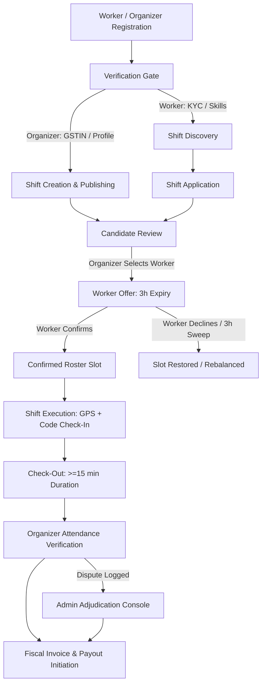

# OPSKL — End-to-End Product Workflow Map & System Architecture

**Document Version:** 1.0.0  
**Status:** Verified against latest repository state (`main` branch)  
**Author:** Principal Product Manager & Full-Stack Systems Architect  
**Review Target:** Worker Mobile App (`apps/worker`), Organizer Mobile App (`apps/organizer`), Admin Web Portal (`apps/admin`), Shared Services (`packages/shared`), and Supabase Backend (`supabase/migrations`).

---

## 1. Executive Workflow Architecture

Opskl connects temporary event workforce with event organizers in India, with primary operations localized to the Mumbai Metropolitan Region (MMR). The architecture enforces an authoritative PostgreSQL/Supabase backend with Row Level Security (RLS), security-definer Remote Procedure Calls (RPCs), and deterministic notification idempotency.

---

## 2. Role-Based Workflow Details

### 2.1 Worker Lifecycles (`apps/worker`)

#### Flow W-1: Authentication & Resumable Onboarding
- **User Action:** Worker inputs email/password or mobile number.
- **UI Validation:** 6-digit OTP schema or email format validated via `@opskil/validation`.
- **API / Service:** `supabase.auth.signUp()` with strict `email_confirm: false`. Direct admin creation routes are strictly forbidden from public access (`authorizeWorkflow`).
- **Authorization:** Unconfirmed sessions cannot access verified marketplace feeds.
- **Onboarding Flow:**
  - Step 1: Basic details, neutral locality selection (BKC, Bandi, Goregaon, Andheri, Lower Parel, Navi Mumbai), bio.
  - Step 2: Skill category selection (hospitality, security, usher, setup, runner, ticketing) with zero pre-seeded default skills.
  - Step 3: Bank account or UPI ID details (encrypted / masked storage).
- **Persisted State:** `profiles.role = 'worker'`, `profiles.onboarding_completed = true`.
- **Handoff / Deep Link:** Directs to `/(tabs)/marketplace`.

#### Flow W-2: KYC Identity Submission
- **User Action:** Worker uploads Government ID (Aadhaar / PAN card front & back).
- **Storage Policy:** Private bucket `kyc-documents` with RLS allowing only owner upload and admin inspection. Direct public reads strictly denied (`storage.objects` RLS).
- **RPC / Service:** `submit_worker_kyc_safe(p_worker_id, p_doc_type, p_doc_number, p_file_urls)`.
- **Persisted State:** `worker_profiles.kyc_status = 'pending_verification'`.
- **Admin Handoff:** Ingested into `admin_kyc_queue` with SLA timer.
- **Notification:** Worker receives `kyc_submitted` notification. If rejected, displays specific admin reason and re-upload CTA.

#### Flow W-3: Shift Discovery & Application
- **User Action:** Worker browses `/marketplace` feed with filters for locality, date, and minimum wage.
- **Database Query:** `get_discovery_feed()` via keyset pagination (`(created_at, id) < ($last_created, $last_id)`). Shields organizer GSTIN and supervisor private phone number (`public_jobs` view).
- **Application Action:** Worker taps "Apply Now" (`apply_for_job_safe(p_job_id, p_note)`).
- **Authoritative Invariants:**
  - Worker must not be in `suspended` or `banned` status.
  - Worker cannot submit duplicate applications for the same shift (`duplicate key` check).
  - Shift must be in `open` status.
- **Persisted State:** `applications.status = 'applied'`.
- **Notification:** Push notification sent to Organizer team (`application_received`).

#### Flow W-4: Selection, Offer Expiry & Confirmation
- **Trigger:** Organizer selects worker from candidate pool.
- **Booking Creation:** Booking row generated with status `selected_awaiting_confirmation` and `offer_expires_at = NOW() + INTERVAL '3 hours'`.
- **Notification:** Urgent push notification dispatched: *"Confirm your shift within 3 hours to lock your spot"* with deep link `/(tabs)/my-shifts`.
- **Worker Acceptance:** Worker taps "Confirm Shift" -> calls `worker_confirm_selection_safe(p_booking_id)`.
  - Invariant: Current time must be strictly `< offer_expires_at`.
  - Invariant: Worker must have no conflicting overlapping confirmed shifts (including overnight shifts crossing midnight).
  - State Transition: `bookings.status = 'confirmed'`, `jobs.slots_filled` atomically incremented.
- **Worker Decline:** If worker declines or 3h expires (`sweep_expired_worker_offers_safe`), status becomes `declined` or `expired`, and slot count is restored.

#### Flow W-5: Shift Day Execution (GPS & Check-In/Out)
- **Check-In Step:**
  - Worker arrives at venue; app requests foreground GPS coordinates (`expo-location`).
  - Worker inputs 6-digit shift code provided by supervisor on-site.
  - Client calls `check_in_worker_safe(p_booking_id, p_code, p_lat, p_lon)`.
  - Server verifies:
    - Code matches `bookings.check_in_code`.
    - Coordinates are within configured venue radius (default 500m geofence).
    - Status transitions to `checked_in`.
    - Deterministic attendance record inserted in `attendance_records`.
- **Check-Out Step:**
  - Worker taps "Check Out" -> calls `check_out_worker_safe(p_booking_id, p_notes)`.
  - Invariant: Rejects checkout if duration `< 15 minutes` (`MINIMUM_SHIFT_DURATION`).
  - Persisted State: `bookings.status = 'checked_out'`, `check_out_time = NOW()`.

---

### 2.2 Organizer Lifecycles (`apps/organizer`)

#### Flow O-1: Shift Creation & Publishing
- **User Action:** Organizer fills multi-step form: Role title, category, venue, Mumbai locality, dates, timings, break duration, wage rate, slots required, supervisor contact.
- **Validation:**
  - Hourly rate must meet or exceed Mumbai platform floor (₹100/hr baseline).
  - Geographic coordinates validated within sovereign India bounding box (6°N–38°N, 68°E–98°E).
  - Shifts on the current calendar day must have start time in the future (IST calculation).
  - Break duration must be between 0 and 120 minutes and strictly less than total duration.
- **RPC Call:** `create_job_safe(...)`.
- **Persisted State:** `jobs.status = 'open'`, `application_deadline` and `payment_deadline` computed.
- **Duplicate Guard:** Reject duplicate publication within 60s throttle window (`DUPLICATE_PUBLICATION`).

#### Flow O-2: Applicant Screening & Selection
- **Organizer Console:** `/shift/[id]/applicants`.
- **Candidate Actions:**
  - View worker profile, verified badges, past completed shift count, ratings.
  - Shortlist worker: `update_application_status_safe(p_app_id, 'shortlisted')`.
  - Reject worker: `update_application_status_safe(p_app_id, 'rejected')`.
  - Select candidate: `confirm_worker_booking_safe(p_job_id, p_worker_id)` -> creates `selected_awaiting_confirmation` booking.

#### Flow O-3: Live Shift Attendance Console
- **Console Route:** `/shift/attendance?id=[jobId]`.
- **Supervisor Actions:**
  - Display daily 6-digit venue check-in code.
  - Real-time roster reflects `checked_in`, `checked_out`, `no_show`.
  - Mark No-Show: `record_no_show_safe(p_booking_id, p_reason)` -> releases capacity or locks booking.
  - Complete Shift & Approve Attendance: `complete_shift_and_approve_attendance(p_booking_id, p_hours_worked, p_supervisor_verified, p_notes)`.
  - Pay Calculation: Authoritative billable hours computed (scheduled duration less unpaid break, or verified hours). `approved_total_pay` persisted.

#### Flow O-4: Invoice Generation & Payout
- **Invoice Generation:** `generate_job_invoice_safe(p_job_id)`.
  - Restricts access to authorized organizer team members or admin.
  - Bills only actual confirmed / attended staff.
  - Computes sequential FY invoice number: `OPS/YY-YY/XXXXX` via atomic sequence `invoice_fiscal_sequences`.
- **Payout Authorization:** `initiate_worker_payout_safe(p_booking_id, p_payout_account, p_idempotency_key)`.
  - Requires `bookings.status = 'completed'` and `approved_total_pay IS NOT NULL`.
  - Fails closed if active unresolved dispute exists on booking.

---

### 2.3 Admin Lifecycles (`apps/admin`)

#### Flow A-1: Staff Identity & KYC Queue
- **Route:** `/admin/kyc`.
- **Capabilities:** Review identity documents, zoom view, cross-reference name, match DOB.
- **Actions:**
  - Approve: sets `worker_profiles.kyc_status = 'verified'`, unlocks full platform features.
  - Reject: prompts required rejection reason (e.g., blurry photo, mismatched name), notifications sent to worker.

#### Flow A-2: Dispute Adjudication & Safety Incidents
- **Route:** `/admin/disputes` and `/admin/safety`.
- **Actions:**
  - Review dispute evidence, supervisor check-in logs, GPS distance logs.
  - Resolve Dispute: `resolve_dispute_safe(p_dispute_id, p_resolution, p_payout_adjustment)`.
  - Updates `disputes.status = 'resolved'`. If dismissed, restores pre-dispute booking status. If adjusted, updates `approved_total_pay`.

#### Flow A-3: Emergency System Controls
- **Route:** `/admin/platform-settings`.
- **Safety Pause:** Platform-wide shift booking suspension: `set_platform_safety_pause(p_paused, p_reason)`.
- **Enforcement:** All worker confirmations, shift applications, and new bookings fail immediately when safety pause is active.

---

## 3. Verified State Transitions Matrix

| Entity | Initial Status | Allowed Transitions | Guard / Invariant RPC |
| :--- | :--- | :--- | :--- |
| **Job** | `draft` | `open`, `cancelled` | `validate_job_transition()` |
| **Job** | `open` | `filled`, `in_progress`, `cancelled`, `paused` | `validate_job_transition()` |
| **Job** | `in_progress` | `completed`, `cancelled` | Cannot cancel if checked-in workers exist |
| **Job** | `completed` | *Terminal* | Immutable |
| **Application** | `applied` | `shortlisted`, `rejected`, `withdrawn` | `update_application_status_safe()` |
| **Application** | `shortlisted` | `selected`, `rejected` | Owner verification |
| **Booking** | `selected_awaiting_confirmation` | `confirmed`, `declined`, `expired` | `worker_confirm_selection_safe()`, `sweep_expired_worker_offers_safe()` |
| **Booking** | `confirmed` | `checked_in`, `no_show`, `cancelled` | Geofence + code verification |
| **Booking** | `checked_in` | `checked_out`, `disputed` | Min 15m shift duration check |
| **Booking** | `checked_out` | `completed`, `disputed` | `complete_shift_and_approve_attendance()` |
| **Booking** | `completed` | `paid` | `initiate_worker_payout_safe()` |
| **Dispute** | `open` | `under_review`, `resolved`, `dismissed` | `resolve_dispute_safe()` |

---

## 4. Cross-Product Handoff Analysis & Fragility Checks

### Handoff 1: Application -> Organizer Notification -> Review
- **Code Path:** `apply_for_job_safe` -> `applications` INSERT trigger -> `buildApplicationReceivedNotification`.
- **Verification:** Worker application successfully reflects in organizer candidate list.
- **Risk Handled:** Organizer team members only see applicants for jobs owned by their organization.

### Handoff 2: Selection -> Worker Offer Expiry Window
- **Code Path:** Organizer creates booking -> `buildWorkerSelectedNotification` sent with 3-hour expiry.
- **Verification:** Worker receives push notification and sees countdown in `my-shifts`.
- **Remediated Gap:** Previously, notification copy stated 30 minutes, but backend enforced 3 hours. Now synchronized to authoritative 3 hours. Deep link fixed to direct to `/(tabs)/my-shifts`.

### Handoff 3: Check-in / Check-out -> Attendance Review -> Invoice
- **Code Path:** Check-in -> Attendance record created -> Organizer reviews in console -> `complete_shift_and_approve_attendance` sets `approved_total_pay` -> `generate_job_invoice_safe` bills actual slots.
- **Verification:** Verified by live PostgreSQL lifecycle test (`scripts/test_lifecycle_db.mjs` step 7b/8).
